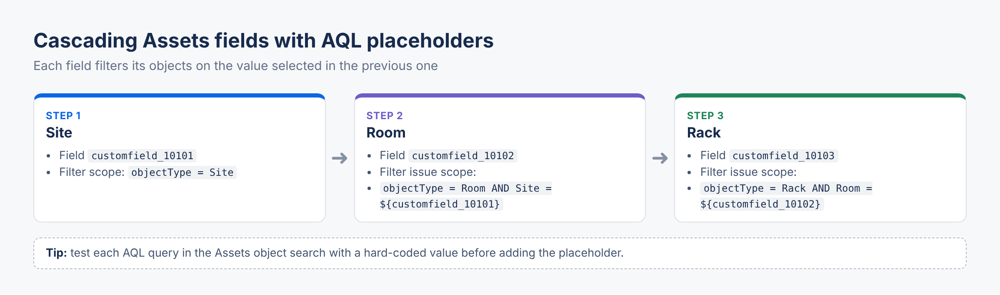

# Jira Assets AQL Cheatsheet


A practical reference for **AQL (Assets Query Language)** in Jira Service Management Cloud: the syntax you need day to day, the patterns that come up in real projects, and the traps that cost time.



> Attribute and object type names below (`Server`, `Owner`, `Status`…) are examples. Replace them with the names from your own schema. Names containing spaces must be wrapped in double quotes.

## Contents

1. [Basics](#1-basics)
2. [Operators](#2-operators)
3. [Searching by type and schema](#3-searching-by-type-and-schema)
4. [References between objects](#4-references-between-objects)
5. [Dates and users](#5-dates-and-users)
6. [Linking objects to Jira issues](#6-linking-objects-to-jira-issues)
7. [Dynamic filters in the Assets custom field](#7-dynamic-filters-in-the-assets-custom-field)
8. [Using AQL from JQL](#8-using-aql-from-jql)
9. [Common mistakes](#9-common-mistakes)

---

## 1. Basics

```sql
-- Attribute = value
Name = "srv-web-01"

-- Quotes are required as soon as a name or a value contains a space
"Operating System" = "Ubuntu 22.04"

-- Combine with AND / OR, group with parentheses
objectType = Server AND (Status = Running OR Status = Maintenance)

-- Sort results
objectType = Server ORDER BY Name ASC
```

Reserved keywords available on every object:

| Keyword | Meaning |
|---|---|
| `objectType` | Object type name |
| `objectTypeId` | Object type ID |
| `objectSchema` | Schema name |
| `objectSchemaId` | Schema ID |
| `objectId` | Numeric ID of the object |
| `Key` | Object key, e.g. `ITAM-123` |
| `Label` | Value of the label attribute |
| `anyAttribute` | Any attribute of the object |

## 2. Operators

| Operator | Example | Note |
|---|---|---|
| `=` / `!=` | `Status = Running` | Case-insensitive |
| `==` | `Name == "SRV-WEB-01"` | Case-sensitive |
| `<` `>` `<=` `>=` | `"RAM (GB)" >= 16` | Numbers and dates |
| `like` / `not like` | `Name like web` | Contains |
| `startswith` / `endswith` | `Name startswith "srv-"` | |
| `in()` / `not in()` | `Status in (Running, Maintenance)` | |
| `is EMPTY` / `is not EMPTY` | `Owner is EMPTY` | Finds incomplete records |
| `having` / `not having` | see [section 4](#4-references-between-objects) | References and tickets |

```sql
-- Free-text search on all attributes
anyAttribute like "10.0.12"
```

## 3. Searching by type and schema

```sql
-- One object type
objectType = Laptop

-- An object type and all its children in the hierarchy
objectType in objectTypeAndChildren("Hardware")

-- Restrict to a schema
objectSchema = "IT Assets" AND objectType = Server

-- A specific object
Key = ITAM-123
objectId = 4521
```

## 4. References between objects

**Dot notation** reads an attribute of a referenced object:

```sql
-- Servers hosted in the Paris datacenter
objectType = Server AND Location.Name = "Paris DC1"

-- Laptops owned by someone in the Finance department
objectType = Laptop AND Owner.Department = Finance
```

**`having`** filters on the references themselves:

```sql
-- Applications that reference at least one server
objectType = Application AND object having outboundReferences(objectType = Server)

-- Servers referenced by a business-critical application
objectType = Server
  AND object having inboundReferences(objectType = Application AND Criticality = High)

-- Orphans: servers no application points to
objectType = Server AND object not having inboundReferences()
```

`outboundReferences()` = references **from** the object, `inboundReferences()` = references **to** the object.

## 5. Dates and users

```sql
-- Created during the last 7 days
Created > now(-7d)

-- Warranty expiring in the next 30 days
"Warranty End" > now() AND "Warranty End" < now(30d)

-- Updated since the start of the month
Updated >= startOfMonth()

-- Objects owned by the current user
Owner = currentUser()
```

Useful date functions: `now()`, `startOfDay()`, `endOfDay()`, `startOfWeek()`, `endOfWeek()`, `startOfMonth()`, `endOfMonth()`, `startOfYear()`, `endOfYear()`. Pass an offset to shift the date, e.g. `now(-7d)` or `now(30d)`.

## 6. Linking objects to Jira issues

`connectedTickets()` filters objects on the issues they are attached to, using JQL inside AQL:

```sql
-- Servers with at least one open incident
objectType = Server
  AND object having connectedTickets(issuetype = Incident AND statusCategory != Done)

-- Business services with no ticket at all
objectType = "Business Service" AND object not having connectedTickets()
```

## 7. Dynamic filters in the Assets custom field

In the Assets object field configuration, two AQL filters exist:

| Setting | Role |
|---|---|
| **Filter scope** | Which objects can ever be selected in the field |
| **Filter issue scope** | Narrows the list based on the **current issue**, with placeholders |

Placeholders reference another field of the issue with `${customfield_XXXXX}` (replace with the field ID). This is how you build **cascading Assets fields**:

```sql
-- Field 1 "Site" (customfield_10101): objectType = Site
-- Field 2 "Room", filter issue scope: only rooms of the selected site
objectType = Room AND Site = ${customfield_10101}

-- Field 3 "Rack": only racks in the selected room
objectType = Rack AND Room = ${customfield_10102}
```

Tips:

- Find the field ID in *Settings > Issues > Custom fields*, or in the URL when editing the field.
- When the referenced field is empty, the filter returns nothing: make the parent field required on the request type, or order the fields so users fill it first.
- Test the AQL in the Assets object search first, with a hard-coded value instead of the placeholder.

## 8. Using AQL from JQL

```sql
-- Issues whose "Affected services" field contains a critical service
"Affected services" in aqlFunction("objectType = \"Business Service\" AND Criticality = High")
```

Escape inner double quotes with `\"`. This is handy for queues, dashboards and eazyBI imports filtered on asset attributes.

## 9. Common mistakes

| Symptom | Likely cause |
|---|---|
| Query returns nothing | Missing quotes around a name or value with a space |
| `like` matches too much | `like` means *contains*; use `startswith` or `=` |
| Reference filter ignored | Using the referenced object's key instead of `Attribute.Name` or the referenced attribute |
| Cascading field empty | Wrong `customfield_XXXXX` ID, or parent field not filled yet |
| Slow queries on large schemas | Free-text `anyAttribute like` on every object type: restrict with `objectType` first |

## Contributing

Spotted an error or have a pattern worth sharing? Issues and pull requests are welcome.

## License

MIT
